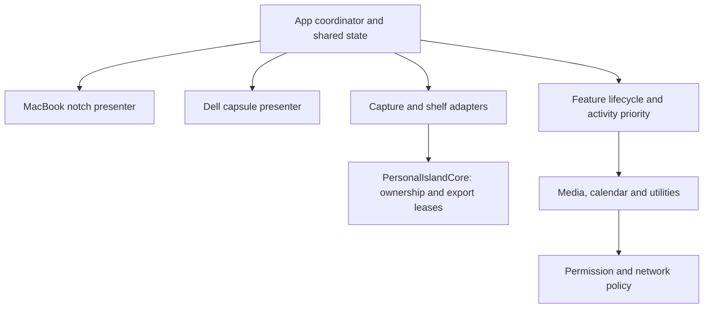

# Build and implementation plan

Updated November 11, 2026. The product requirements are in [PLAN.md](PLAN.md); the source findings are in [SECURITY_REVIEW.md](SECURITY_REVIEW.md). Face unlock is deferred. This document turns the accepted scope into buildable stages and completion gates.

## Implementation decisions

- Keep **all accepted utilities** in the product: screenshots/file shelf, Spotify and other players, calendar, battery, connections, transfers, timers, lock-screen widgets/weather, statistics, clipboard, visualizer/lyrics, color picker, Focus, and recording indicators.
- Use one controlled app host with deliberate component ports. Atoll is the primary reviewed reference because of its breadth; its entire startup/dependency graph is not inherited. Port individual DynamicNotch components where useful, especially floating capsule/display behavior and connection activities. Do not merge two complete app coordinators/settings systems.
- Build the new storage/export engine as a dependency-free local Swift package, **PersonalIslandCore**, so the most sensitive cleanup rules can be tested now and then integrated into the chosen app. This does not replace the full feature scope or imply the upstream apps have already been built.
- Preserve pinned audit snapshots. Work in the separate PersonalIslandApp source tree; retain licenses/notices and record copied files and upstream commits. Obtain complete matching upstream assets and dependency/helper source before later ports that require them.
- Treat permissions, outbound connections, storage ownership, and feature lifecycle as explicit interfaces. A setting that hides a feature must also stop its collectors and work.

## Build environment and resolved toolchain constraint

Initial check on November 11, before Xcode installation:

| Item | Observed state | Consequence |
| --- | --- | --- |
| Developer directory | `/Library/Developer/CommandLineTools` | Command-line Swift builds are available. |
| Compiler | Apple Swift 6.1.2, Apple silicon target | Suitable for the independent Foundation storage package. |
| macOS SDK | 15.5 | Does not contain the newer SwiftUI declarations used in parts of Atoll. |
| `xcodebuild` | Reports that full Xcode must be selected | The upstream Xcode project cannot currently be built through the selected tools. |
| Standard Applications folder | No `Xcode*.app` found directly there | No full Xcode installation was identified in that location; this is not an exhaustive disk search. |
| Audit source trees | Selected text only | Images, Metal source, executable frameworks and symlinks were intentionally excluded. They are evidence snapshots, not complete build checkouts. |

Atoll uses `glassEffect` behind runtime availability checks. A runtime check does not give an older SDK declarations it does not contain. A compatible full Xcode providing a current SDK is required for the unchanged full interface, or those portions must be deliberately adapted. For this macOS 27 machine, use an appropriate stable Xcode 27 toolchain when preparing the complete app target. Check Apple's compatibility table rather than treating the old README's Xcode minimum as sufficient. [Apple SDK requirements](https://developer.apple.com/xcode/system-requirements)

The storage package is independent of that prerequisite. No Xcode installation, global toolchain change, app launch, login item, or personal-data access is needed for its synthetic tests.

**Update after the user's Xcode installation:** `/Applications/Xcode.app/Contents/Developer` is selected, Xcode 27.2 (27B52) and SDK 27.2 are available, Swift reports 6.4.2, and the first-launch setup check passes. The unchanged core passes all 19 tests with these tools. The toolchain blocker is resolved.

The first graphical integration uses a new explicit-source Xcode target rather than executing the upstream project unchanged. It compiles the local core source and deliberate presentation ports only. This provides a reviewable host without automatically including unsafe upstream startup modules, helper binaries or packages. A complete upstream checkout/dependency implementation review is still needed for later unchanged feature ports; the host is not described as a completed hardened Atoll fork.

## Architecture

| Boundary | Responsibility | Must not do |
| --- | --- | --- |
| App coordinator | One shared collection, selected activity, feature status and lifecycle | Duplicate collectors for each screen. |
| Display presenters | Geometry, compact/expanded views, focus, keyboard and pointer interaction | Own screenshot storage or independently fetch data. |
| Core shelf | In-memory captures, imported references, count/byte limits, safe removal | Move or delete imported originals. |
| Export leases | Generated temporary PNGs, ownership records, retention/recovery | Treat drag completion as upload completion or delete untracked files. |
| Capture adapter | On-demand region/window/display capture and preview generation | Change global screenshot preferences or continuously record for the shelf. |
| Drag adapter | Image representations, file promises, compatible file URLs, multi-selection | Delete a source when a drag begins; clean receiver-owned destination copies. |
| Feature modules | Media/calendar/status/utility behavior with start/stop and capability state | Leave observers, subprocesses, audio taps or requests running after disable. |
| Policy/settings | Permission reasons, online providers, retention, privacy and diagnostics | Store account passwords or secrets in ordinary preferences. |

Interface statuses should distinguish disabled, permission-needed, available, unavailable, and failed. An unavailable private integration must not masquerade as a zero metric or a working feature. Capability checks belong in settings/diagnostics, with plain product messages for normal use.

For M0, keep shelf state and export leases inside one actor so an export cannot race source removal through a second coordinator. These are separate responsibilities within that actor, not a requirement for two independent stores. The app must share this single store between both presenters.

## M0 — Safe shelf and export foundation

**Deliverable:** a locally buildable Swift library and meaningful tests using synthetic temporary files. No GUI, capture, clipboard, accounts, or upstream helpers are involved.

Implement the following invariants:

1. Screenshot PNG bytes stay in memory until an export is needed. Start with a maximum of 20 captures and 128 MiB encoded bytes; reject additional admission visibly rather than silently evicting an active selection.
2. Imported files are references. Clear, remove, expiry, restart recovery and export cleanup never remove or move those originals.
3. Exports use generated identifiers inside a private app-owned directory. Caller display names never become cleanup paths. Reject unsafe roots, symlinks, malformed/out-of-root or inconsistent ownership records, and overwriting collisions.
4. Publish an export URL only after its file and ownership record are committed. Preserve unknown files when a catalog is missing or corrupt; do not reuse the audited orphan-deletion approach.
5. Protect exports while the source remains on the shelf, during an active drag, and for at least 24 hours after last use. Ending/canceling a drag releases only drag protection. It does not remove the shelf item or prove an attachment was sent.
6. Persist only export ownership/timing metadata for restart cleanup; do not restore screenshot shelf contents. Cleanup runs while the app is running and at next launch. No promise is made that it runs while the app is closed.
7. Bound export admission separately from screenshot RAM. Start with at most 256 retained exports and 512 MiB of retained PNG payloads. Reject new exports at capacity without evicting protected leases; cleanup can release capacity after eligibility. These payload budgets do not include filesystem metadata, receiver copies, or overall process memory.

Tests must cover original/outside sentinel preservation, corrupt/missing/inconsistent metadata, symlinks/path traversal, partial failures, source/drag protection, repeated/canceled/overlapping drags, restart grace periods, and capacity rejection without data loss. Record limitations that still require an OS drag test. The core protects cleanup against corrupt metadata, accidental ownership confusion, and path escape; local metadata validation does not authenticate a catalog against an arbitrary malicious process running as the same user with permission to rewrite both files and records.

**Completion gate:** package builds with the selected tools; meaningful synthetic tests pass; source review verifies there is no network, updater, credential access, imported-original deletion, or dependency on upstream binary helpers. This gate does not establish Discord compatibility.

## M1 — Controlled app host and packaging

This can proceed alongside M0 once the compatible full toolchain is available.

1. Create a separate explicit-source host with deliberate ports from Atoll `b8d86a2d8118d905ffa3e2c912adc736683741bb`. Keep DynamicNotch `f8623de5806ec5a22d9845189360bc9f4d92c374` as the reviewed component reference. Do not advance upstream revisions without reviewing the changes. A complete matching source/assets checkout remains necessary before importing feature code that depends on omitted material.
2. Inventory Swift packages, binary targets, build plugins, scripts, copied executables, linked frameworks and startup tasks before resolving/building them. A Swift package is not necessarily source-only.
3. Create a personal application identity and build configuration. Replace upstream team/bundle/Developer ID assumptions; make the build repeatable without a paid distribution workflow. Apple notes that running a macOS app on your own Mac does not require signing setup unless added capabilities require provisioning. Persistent privacy grants and helper signing still need validation for our configuration. [Apple local-run guidance](https://developer.apple.com/documentation/xcode/building-and-running-an-app)
4. Keep unrequested AI/usage-dashboard/terminal modules, camera/password unlock, extension hosting, and upstream Sparkle updates outside the target. If reusing upstream project pieces later, remove startup calls, UI routes, imports, package products, plist entries, entitlements, resources and signing phases coherently. Atoll's synchronized source folder includes files automatically: changing a default to false is insufficient exclusion.
5. Use an explicit source/feature inclusion list. Integrate PersonalIslandCore as a local library and adapt the screenshot/shelf UI to its ownership rules.
6. Exclude the MediaRemote adapter from this initial host. Before broader-player integration in M3/M4, rebuild it from reviewed matching source or replace it. The audited Atoll target copies a prebuilt framework rather than compiling its implementation; broad-player support remains unverified until that boundary is resolved.
7. Keep hardened runtime and inspect the actual resulting bundle/entitlements. Avoid blanket cleartext exceptions, disabled library validation, unintended local listeners, upstream update feeds and unrelated embedded helpers.

**Completion gate:** a locally built `.app` bundle with a dependency/provenance receipt and bundle inspection. It has settings and Quit, no automatic personal-data collection, no unsafe omitted features, and no inherited upstream updater. Compilation is not a security or feature-completeness certificate.

**Current checkpoint:** the explicit-source Release host builds and passes bundle/signature checks. Sources define settings/Quit and per-display presenters, but no launch has verified those interactions. See PersonalIslandApp/VERIFICATION.md and implementation/APP_SOURCE_PROVENANCE.json. This initial host does not complete capture, dragging or any account/utility integration.

## M2 — First usable screenshot island on both screens

Connect region capture to the core, then add AppKit dragging and a shared shelf UI. Adapt the notch/capsule presenters, menu-bar access, keyboard controls and activity arbitration. Start with a plain functional view before animation polish. Add window/display capture after region capture is stable.

Connect cleanup scheduling at startup and periodically while running before the UI can create exports. M1 initializes storage lazily and does not yet schedule sweeps. Surface storage and capacity failures without exposing screenshot contents or deleting unknown files.

**Completion gate:**

- Both presenters show one collection; captures/removals update both.
- Capture hides its own overlays and preserves image fidelity at the MacBook and Dell's scaling settings.
- Capture/hover does not steal typing focus. Selection/drag holds the shelf open.
- Synthetic single/multi-image attachments reach Discord desktop, Mail and Messages composers. Verify canceled/repeated drags, delayed drafts, app switching, retention and restart. Attachment staging can upload before final Send; any real service test must account for the receiver's behavior. Do not send messages to people as a test.
- Clamshell, unplug/replug, fullscreen, Spaces, menu-bar auto-hide, 4K scaling and mixed refresh rates do not strand the island or duplicate alerts.
- Clear All and cleanup leave original imported documents intact.

**This is the first usable preview**, with incomplete integrations clearly tracked. It is not the full product.

## M3 — Spotify and Apple Calendar

Use the local Spotify interface first: metadata, play/pause, previous/next, progress and seeking after timing-unit verification. No web login is required for basic controls. Keep artwork downloading independently configurable; avoid adopting the cookie-based Canvas credential flow by default.

Use EventKit for selected calendars already synchronized to Apple Calendar. Display today's agenda and next event. Keep the implementation display-only while accurately explaining Apple's full-access permission for reading.

**Completion gate:** denial/revocation and stopped/empty sources are handled; changing a feature switch stops its work; event changes/time zones/all-day events/sleep-wake work; controls remain synchronized on both screens; sensitive text is hidden on the lock screen by default. No calendar-event writes or reminder-completion changes are needed for this agenda.

## M4 — Complete every accepted utility group

First run early compatibility checks for the highest-uncertainty pieces: actual lock-screen windowing, a rebuilt broader-media adapter, M5 GPU counters, Focus detection, and AirDrop/download observation. Use capability results to guide adaptation without silently dropping requested features.

| Group | Implementation work | Acceptance evidence |
| --- | --- | --- |
| Battery/charging | Adapt local power observers and alert routing. | Correct transitions; one alert across two presenters. |
| Connections | Bluetooth/Wi-Fi/VPN/hotspot observation; separate online VPN-country lookup. | Connect/disconnect and unavailable-state tests; online requests stop when disabled. |
| Downloads/AirDrop | Adapt bounded observation and explicit system sharing. | Real progress/completion/cancel events; no unsolicited transfer. |
| Timers | Own countdown model; distinguish system Clock observation. | Pause/resume, sleep/wake, cancel and chosen restart behavior. |
| Lock-screen widgets/weather | Port presentation after platform checks; per-widget privacy and selected-city weather. | Real locked-session checks, hidden private data, configured destinations and manual recovery. No unlock/password feature. |
| System statistics | Shared CPU/GPU/RAM/network/disk collectors. | Values validated against system tools where available; hidden/disabled sampling stops. |
| Clipboard history | Opt-in observation, session retention, exclusions, byte budgets and safe image export. | Pause/clear/expiry; sensitive markers respected; original data not leaked into diagnostics; image drags work without persistent storage. |
| Media extras | Tested additional-player adapters, lyrics, decorative and real-audio visualization modes. | Player compatibility list; lyrics request transparency; audio taps/animation stop when unused. |
| Other utilities | Color picker, Focus status, recording indicators and scoped explicit actions. | Correct local state; denied-permission behavior; no broad process termination as a default action. |

M4 can run in parallel lanes after shared interfaces stabilize: (A) collectors/transfers/timers, (B) media/online metadata, (C) lock-screen/privacy/clipboard/statistics. Shared coordinator, storage and policy changes require integration review rather than competing implementations.

## M5 — Personal-use qualification

- Measure idle CPU, memory, energy and network traffic with all modules disabled, then enable each separately. Repeat with both displays, visible statistics, visualizer, battery power and sleep/wake. Publish measured results; do not invent percentage improvements.
- Verify outbound destinations and payload classes against policy: weather, lyrics, artwork and optional VPN location. Provide a useful offline state and bounded caches. Keep logs free of clipboard/screenshot/calendar contents, paths and tokens.
- Validate persistence, malformed metadata, export recovery, permission revocation, private-API failure, crashes, update/rebuild migration and uninstall behavior.
- Check keyboard navigation, reduced motion, contrast, click/hover preferences and focus handling.
- Add optional login startup only when enabled. Use a stable build identity and document how privacy permissions behave across rebuilds.
- Produce a local `.app`, repeatable build instructions, dependency/source receipt and a feature-by-feature status matrix. Keep every incomplete or unavailable integration explicit.

Full completion requires M5 and resolution of every accepted feature row. A passing core test or successful app build alone is insufficient.

## Activation defaults and source control

All accepted features remain available in the design, with independent switches. Initial startup has no upstream updater, extension server, AI/terminal/usage-dashboard integration, LocalSend discovery, face unlock, automatic clipboard collection, private lock-screen previews, or login item. Online lookups require configuration. Clipboard becomes session-only when enabled. Normal battery/status/timer functionality can operate locally.

The user has authorized private version control in `yuvanmuru-dev/personal-island`. Keep hardening changes in reviewable commits, retain upstream notices and record source copies in a provenance manifest. Reference archives, personal content, machine-specific evidence and build outputs stay local. Public publishing, external messaging and app distribution are outside the current scope.

## Immediate execution and remaining decisions

Completed checkpoint: M0 is implemented and tested; Xcode is installed/selected by the user, and the initial controlled graphical host builds and passes bundle/signature inspection. Next is M2: capture, native drag adapters, cleanup scheduling and actual two-display/attachment verification. Complete upstream source/assets and dependency/helper review remain prerequisites for relevant later ports. The user subsequently opened the built preview and confirmed a visible island. Both-screen placement and interactions remain unchecked. No login startup, personal-data permission grant or authentication change has been performed.

The working name “Personal Island” is a placeholder. Shortcut, hover delay, visual theme, weather city, clipboard retention and ordinary-file-reference persistence can be adjusted during the preview; they do not block the storage foundation. Face unlock has no active work and does not block any milestone.
