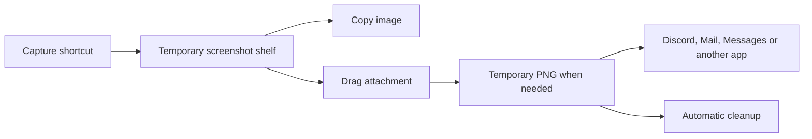

# Personal Mac island — working plan

Research date: November 10, 2026; scope updated November 12, 2026. Status: the storage/export core passes 33 synthetic tests, and the controlled graphical host builds and passes bundle/signature inspection with Xcode 27.2. Presentation and build-policy regression suites are also implemented. Private version control and automatic checks are configured in `yuvanmuru-dev/personal-island`; the expanded local verification passes 183 tests and the Release build/bundle checks. The user has opened the preview and confirmed a visible island; both-screen placement and interactions remain unchecked. Capture, native dragging and the accepted integrations remain unfinished. Pinned source-only snapshots remain unchanged review evidence. Face unlock is deferred. Build sequence and completion gates are in [BUILD_IMPLEMENTATION_PLAN.md](BUILD_IMPLEMENTATION_PLAN.md); current verification is tracked in [IMPLEMENTATION_STATUS.md](IMPLEMENTATION_STATUS.md).

## Confirmed requirements

- Target: 14-inch M5 MacBook Pro, plus a 27-inch Dell 4K 120 Hz monitor. The local system reports macOS 27.0.1; the user calls it GoldenGate.
- Build a personally controlled native application from source. The user explicitly permits copying/adapting open-source components or maintaining a local fork if that is the best approach. Original implementation is not a requirement. Personal use is intended; distribution is not planned.
- No subscription or paid developer membership for personal local use. Apple says membership is not required to build and test on personal devices. Apple development tools are still necessary. [Apple membership overview](https://developer.apple.com/help/account/membership/programs-overview/)
- Core features: temporary screenshots, a file drop shelf, Spotify desktop controls, and Apple Calendar, including accounts already synchronized to it.
- Expanded scope confirmed: all nine feature groups listed below are wanted, including weather within lock-screen widgets. They are planned features, not an excluded backlog. Each feature should be individually configurable.
- Face unlock is deferred for later at the user's request. Preserve the desired future behavior (face alone, fully hands-free from sleep) and research notes, but do not research or implement it in the current scope.
- Display placement: enabled on both screens, with one shared tray. Use notch presentation on the MacBook and a floating capsule on the Dell.
- Automatically deleted temporary files are acceptable. Screenshots should not accumulate in Desktop, Documents, or another permanent screenshot folder.
- The music source, calendar source, display placement, and full utility scope are confirmed. Start with safe storage and export rules, then integrate the controlled app build and native adapters according to the build plan.

## Product direction

Use one shared shelf and separate presentation on both displays by default. The MacBook presentation expands around the physical notch. The Dell presentation is a small floating capsule near the top center. Both access the same items and integrations: capturing or removing an item on either display updates both. Per-display enable switches still allow laptop-only or Dell-only use. In clamshell mode, keep the Dell presentation available and restore the MacBook presentation when its display returns.

Collapsed: show a small useful status such as playing music, the next event, a timer, a transfer, or screenshot count. Expanded: retain easy access to **Media**, **Calendar**, and **Shelf**, with configurable access to **Timers**, **Stats**, **Clipboard**, and utility actions. Screenshots live in Shelf with a capture button and visible temporary status. A newly captured image briefly appears without stealing typing focus. Keep the shelf open during dragging and selection; other status events must not replace it mid-interaction. Prioritize active interactions over transient status events and avoid showing duplicate alerts from both display presenters.

Allow click and keyboard activation; make hover optional with a short delay. Support Escape, reduced motion, sensible hit areas, and a menu-bar route to settings and Quit. Keep screenshot, clipboard, file, and calendar details hidden on the lock screen by default; provide separately configured lock-screen widgets for selected information. Animate interaction and state changes rather than running a continuous animation at either display's refresh rate. A visualizer may animate while enabled and visible; stop it when hidden or disabled.

## Accepted additional features

The user confirmed all of the following. Documented upstream coverage is an input to choosing a base, not proof of behavior on the M5 MacBook or macOS 27. [Atoll feature list](https://github.com/Ebullioscopic/Atoll#highlights), [DynamicNotch feature list](https://github.com/jackson-storm/DynamicNotch#-highlights)

| Feature group | Planned behavior | Upstream coverage to investigate |
| --- | --- | --- |
| Battery and charging | Charging status, animations, and low/full-charge alerts. | Both projects. |
| Connections | Bluetooth, Wi-Fi, VPN, and personal-hotspot status and events. | DynamicNotch explicitly lists these. |
| Downloads and AirDrop | Transfer activity and progress. | DynamicNotch; Atoll documents download activity and AirDrop-related code. |
| Timers | Create countdowns, pause/resume, and show running timers. | Both projects. Distinguish app-owned timers from observing Apple's Clock timers. |
| Lock-screen widgets | Selected media, timer, charging, Bluetooth, and weather widgets. | Atoll has broad documented coverage; test actual locked-session behavior. |
| System monitoring | CPU, GPU, memory, network, and disk activity. | Atoll. Validate available M5 counters and report unavailable readings honestly. |
| Clipboard history | A searchable/selectable history with copy-back, pause, clear, exclusions, and retention controls. | Atoll; verify exact inherited functionality and adapt gaps. |
| Media extras | Audio visualizer, lyrics, and support for players beyond Spotify. | Both have visualizer-related code; DynamicNotch lists lyrics providers. Exact player coverage needs testing. |
| Other utilities | Color picker, Focus status, and screen-recording indicators. | Atoll lists all three; DynamicNotch lists Focus and recording activities. |

Some integrations may need additional permissions, external data services, or private macOS interfaces. Record these per feature during the audit. When a feature is disabled, stop its observers and work; availability in the app does not mean every integration continuously runs. Nothing in this scope adds an AI assistant, terminal, or model-usage tracker merely because an upstream project also contains one.

## Existing work and what it teaches us

| Reference | Useful influence | Decision for this app |
| --- | --- | --- |
| [Atoll](https://github.com/Ebullioscopic/Atoll) | Broad utilities, system statistics, clipboard history, calendar, and lock-screen widgets. | First full-source-fork candidate for the expanded scope. Validate Dell presentation and shared state. |
| [DynamicNotch](https://github.com/jackson-storm/DynamicNotch) | Compact/expanded states, floating capsule, and connection/transfer activities. | Alternative base and source for display behavior or features missing from the chosen base. |
| [Boring Notch](https://github.com/TheBoredTeam/boring.notch) | File shelf, media and calendar interactions. | Consider shelf component reuse; validate attachment compatibility and ownership behavior. |
| [NotchNook](https://getnotchnook.com/) | Clear separation between controls and the tray. | Keep frequently used areas easy to reach as the interface gains utilities. |
| [DynamicLake](https://www.dynamiclake.com/) | Compact event feedback and modular actions. | Use short, relevant updates and explicit feature switches. |
| [Dropover](https://dropoverapp.com/kb/take-screenshots) | Capture directly into a shelf, then copy or drag later. | Adopt the workflow with a temporary storage policy; its documented screenshot workflow saves to a chosen folder. |

Both user-linked repositories identify their licenses as GPL-3.0. Source reuse is authorized for this personal project. Preserve the relevant licenses, notices, and attribution with reused components, and record their source repository, exact commit, and local modifications. [Atoll license](https://github.com/Ebullioscopic/Atoll/blob/dev/LICENSE), [DynamicNotch license](https://github.com/jackson-storm/DynamicNotch/blob/main/LICENSE)

Two source-level findings shape the plan:

1. DynamicNotch's screenshot monitor redirects the system screenshot location into its cache and changes screenshot behavior. Its screenshot model can save a dismissed capture to a user folder. Our app instead gets its own capture shortcut and a temporary multi-item shelf. Normal macOS screenshot settings stay under the user's control. [Monitor at reviewed commit](https://github.com/jackson-storm/DynamicNotch/blob/f8623de5806ec5a22d9845189360bc9f4d92c374/DynamicNotch/Features/ScreenshotHub/Services/ScreenshotMonitorService.swift), [storage behavior](https://github.com/jackson-storm/DynamicNotch/blob/f8623de5806ec5a22d9845189360bc9f4d92c374/DynamicNotch/Features/ScreenshotHub/ViewModels/ScreenshotViewModel.swift)
2. Atoll uses private MediaRemote APIs and has several package dependencies. Broader media support is now requested, so audit those adapters rather than automatically excluding them. Keep the direct Spotify integration as a bounded option; isolate broader integrations so they can be disabled or replaced after a macOS update. Prefer Apple frameworks where simpler and retain third-party components where they help accepted features. [Reviewed media source](https://github.com/Ebullioscopic/Atoll/blob/dfc4df5e07b22084a402a3cdb9925f7f038697d7/DynamicIsland/MediaControllers/NowPlayingController.swift), [dependency list](https://github.com/Ebullioscopic/Atoll/blob/dfc4df5e07b22084a402a3cdb9925f7f038697d7/DynamicIsland.xcodeproj/project.xcworkspace/xcshareddata/swiftpm/Package.resolved)

These are design and source findings, not claims that we have tested those applications.

## Source reuse strategy

The expanded scope changes the provisional recommendation: audit a full Atoll source fork first. It documents more of the requested utility set. Compare DynamicNotch as the alternative base, especially for external-display presentation and connection/transfer activities. Adopt one main application, then port individual missing components as needed; combining both complete applications would create competing settings, window ownership, and activity coordination.

Before choosing, create a per-feature matrix at pinned source commits: present, adaptation needed, private integration, unavailable, and tested on this Mac. Include build dependencies and any embedded helper binaries. Verify the selected source can be built locally and identify helpers that must also be built or replaced. Keep updates under the user's control. Select Atoll if its wider utilities and Dell/shared-shelf adaptation work well; prefer DynamicNotch if its actual display behavior and integration quality outweigh the work of adding missing utilities. Neither route has been built or tested yet.

Regardless of the starting point, implement or adapt the screenshot capture/storage lifecycle to the agreed requirements: dedicated capture shortcut, shared multi-item tray, temporary exports, safe cleanup, and no changes to global screenshot preferences. Existing animation or shelf code does not establish that its storage and deletion behavior fits this app. Retain EventKit, a reliable Spotify-specific path, per-feature permission/network controls, and user-controlled updates. The full requested set remains in scope; compatibility findings determine adaptations and delivery sequence rather than silently removing features.

During implementation, maintain a short source/dependency inventory and pin reused code to reviewed commits. This supports the user's control over what is included and updated; it does not require writing every component from scratch.

## Security review and required changes

The [source security review](SECURITY_REVIEW.md) covers Atoll `b8d86a2d8118d905ffa3e2c912adc736683741bb` and DynamicNotch `f8623de5806ec5a22d9845189360bc9f4d92c374`. It combines broad static searches with manual tracing of sensitive paths; embedded binaries, dependency implementations, runtime traffic, and macOS 27 behavior remain unverified. It does not establish that either distributed application is malicious or safe.

Before personal use:

- Remove the unrequested Atoll extension server, or repair its self-authorization, file-access, and unchecked upload-filename boundaries. It is loopback-bound in the reviewed version, not a LAN-open RPC listener.
- Exclude DynamicNotch's camera/password-unlock implementation from the current build. It stores the Mac login password and scans generic face landmarks without identity matching. It requires enrollment and a saved password; an untouched install is not demonstrated to auto-unlock. Face-unlock research and implementation are deferred, while ordinary lock-screen widgets remain in scope.
- Replace tray orphan deletion and screenshot storage/cleanup. DynamicNotch's optional Move import can expose originals to permanent recovery cleanup; default Copy avoids that particular original-file risk.
- Remove the upstream updater for user-controlled rebuilds. Both reviewed snapshots pin Sparkle versions affected by published advisories fixed in 2.9.6; exploitation depends on specific local/privileged installation conditions. Any retained updater must use a currently patched version and a reviewed trust configuration.
- Keep requested clipboard history with session-first retention, exclusions, pause/clear, and working image drag exports. Keep private lock-screen previews independently configurable. These requested features remain in scope.
- Move necessary secrets into Keychain and remove content-bearing diagnostics. Omit unrequested AI assistants, AI-account usage access, terminals, and third-party extension hosting.
- Keep weather, lyrics, artwork, and VPN country lookup independently configurable with explicit destinations/data. Several inherited paths make external requests, including default-on weather and VPN-triggered country lookup. No author-owned clipboard/screenshot/calendar analytics service was identified in reviewed first-party text; unreviewed binaries and runtime behavior prevent a blanket no-sharing claim.
- If LocalSend is retained, fix its trust-any TLS handling, HTTP fallback, peer substitution, and discovery lifecycle. AirDrop and ordinary attachment dragging are separate requested features and remain available in the design.

Optimization work should preserve existing useful caching and visibility gating, remove screenshot directory polling, share collectors between displays, coalesce weather requests, bound clipboard/export memory, stream large transfers, and stop hidden or disabled modules. Measure actual CPU, memory, energy, and traffic before claiming improvements. The review documents specific source evidence and remaining validation gates.

## Face-only unlock — deferred

On November 11, the user asked to hold off on face unlock until later. Stop research and implementation for this feature; it does not block the island, screenshot tray, or other accepted utilities. The [feasibility note](FACE_UNLOCK_FEASIBILITY.md) preserves the findings and the desired future hands-free behavior for a later revisit. No camera enrollment, credential collection, or login-policy changes are planned in the current scope.

## Screenshot workflow

1. Press the app's configurable capture shortcut or click Capture.
2. Select a region. Hide the island and selection overlay before taking the image. Add window and whole-display selection after region capture works reliably.
3. Store encoded image data and a small preview in the shared shelf. Show thumbnail, capture time, Copy, Delete, and an explicit Save action.
4. Later, drag one or more selected thumbnails to a destination. Offer image data and a compatible file representation. Copy Image remains available when a destination handles paste better.
5. Keep the source item available for repeated or canceled drags. Clear only on explicit removal, chosen expiry, or session end.

Use ScreenCaptureKit's `SCScreenshotManager.captureImage(in:)` for region capture. Apple documents rectangle coordinates in screen points and multiple-display support. The installed SDK includes this API, available since macOS 15.2. The richer screenshot APIs in newer online documentation are not necessary for the initial implementation. [Apple capture API](https://developer.apple.com/documentation/screencapturekit/scscreenshotmanager/captureimage(in:completionhandler:))

ScreenCaptureKit's sharing picker selects windows/apps/displays; it does not provide the region crosshair interaction. Implement or adapt that overlay. Capture screenshots only on request, without recording the screen continuously for the screenshot shelf. The separately enabled Clipboard History and recording-status features have their own monitoring behavior. [Apple picker modes](https://developer.apple.com/documentation/screencapturekit/sccontentsharingpickermode)

### Temporary storage and cleanup

The product promise is **no manual screenshot saving or permanent screenshot clutter**. It is not a guarantee that image bytes never reach storage: compatibility exports, macOS memory swapping, and destination-app caches can use disk.

Proposed defaults, to confirm during prototype use:

- Keep screenshot originals in memory until removed or the app quits. Optional expiry can shorten this. Start with a maximum of 20 images and a 128 MiB encoded-data budget, plus a separately bounded thumbnail cache. Notify before discarding an older item; do not silently evict a selected or actively dragged capture.
- Create file exports only when needed, inside an app-owned subdirectory of the system temporary directory. Use generated identifiers and filenames, rather than window titles or personal content.
- Offer PNG/TIFF representations and file promises where supported; use a temporary PNG file URL where needed for interoperability. Apple documents file-promise examples for Finder, Mail, and Photos. Discord and Messages support still needs empirical testing. [File promises](https://developer.apple.com/documentation/appkit/nsfilepromiseprovider), [Apple example](https://developer.apple.com/documentation/appkit/supporting-table-view-drag-and-drop-through-file-promises)
- A provisional compatibility policy retains an exported file for at least 24 hours after its latest use and while its shelf item remains. Expired files are swept while the app runs and at the next launch. If the app is closed, cleanup waits for its next launch; there is no always-running cleanup helper in the baseline.
- Never delete a source merely because dragging started or ended. A successful drop does not confirm an upload or sent message. Long-lived drafts may require the user to retain an item or explicitly save it; validate this behavior before fixing the default grace period.
- Clean only files this app created. Never remove an original imported file or a destination copy created by an intentional Finder drop. If the user clears the shelf, release screenshot memory immediately and retire outstanding exports according to the compatibility grace period.

No Discord, email, or Messages account integration is needed for ordinary manual dragging and sending. The receiving app still controls attachment storage and delivery.

## File shelf, music, and calendar

**File shelf:** drag existing Finder files into Shelf, select several, and drag them out together. Existing files remain in place; shelf entries reference them with the appropriate access/bookmark handling. Imported data without a durable source can use owned temporary storage. Outgoing drags default to copy. “Remove from Shelf” only removes the entry or its owned temporary copy. Distinguish these ownership types in the data model so cleanup cannot delete original documents.

**Spotify desktop and additional players:** Spotify remains the primary player: show title, artist, play/pause, previous/next, and progress through its local scripting interface. The installed scripting dictionary declares these controls, current position, seeking, and track metadata. It supplies an artwork URL; its direct artwork-image property is deprecated and documented as never set. An offline view can use a placeholder; album art downloads are individually configurable. Verify timing units and runtime behavior during implementation before displaying progress. Handle Spotify being closed or having no active track without launching it automatically. Request Automation access specifically for Spotify when enabling that path. Broader player support, lyrics, and a visualizer are now in scope; audit inherited media adapters and maintain a tested player list rather than promising every application works. This was a dictionary-only inspection: Spotify was not launched or controlled. [Installed Spotify interface](/Applications/Spotify.app/Contents/Resources/Spotify.sdef)

Apple's `MPNowPlayingInfoCenter` describes media our app plays; it should not be mistaken for a public universal reader of other applications' media. [Apple Now Playing documentation](https://developer.apple.com/documentation/mediaplayer/mpnowplayinginfocenter)

**Apple Calendar:** show the next event and today's agenda, with selectable calendars and click-through to Calendar or a meeting link. Use display-only behavior through EventKit and the calendars already synchronized to macOS, including the user's synced Google or Outlook accounts. Separate Google/Microsoft sign-ins and direct account integrations are unnecessary for this route. Apple does not expose a read-only EventKit permission: reading events requires its full-access permission even if our implementation only reads. Explain that accurately when enabling Calendar. [Apple event-store permissions](https://developer.apple.com/documentation/eventkit/accessing-the-event-store)

## Native structure and controls

Use Swift + SwiftUI for views, with AppKit panels for overlay positioning and drag behavior. Use screen safe areas and camera-housing geometry rather than hardcoded notch dimensions. Keep one shared model with per-display presenters. Recalculate placement after monitor, scaling, Spaces, and sleep/wake changes. [Apple screen geometry](https://developer.apple.com/documentation/appkit/nsscreen/safeareainsets)

Separate responsibilities: island presentation; shared shelf and item ownership; capture; drag/export leases and cleanup; media; calendar; statistics; clipboard history; timers; system activities; lock-screen widgets; settings and permission status. A failure or denied permission in one module must not stop the others. Persist preferences; do not restore screenshot shelf contents on relaunch. Clipboard history is a separate, explicitly enabled feature with its own retention controls, session-only storage by default, pause/clear controls, and supported sensitive-content exclusions. Respect concealed-content markers where applications provide them; do not claim every password can be detected. Temporary screenshot exports follow the stated retention policy.

Keep application updates a user-controlled local rebuild, with no automatic upstream updates or analytics. Network-backed features now include artwork, lyrics, and weather. Make providers and enable switches visible, cache bounded data, and allow the rest of the app to function offline. Prefer a manually selected weather city over requiring location access. User account synchronization remains owned by macOS Calendar. Identify any private API/helper use per feature and validate it on macOS 27; lock-screen presentation, media adapters, hardware counters, and transfer observation are specific compatibility checkpoints.

| Feature | Access expected |
| --- | --- |
| Capture | macOS screen-capture permission, requested when first used. |
| Calendar | Calendar full-access permission to read events; implementation remains display-only. |
| Spotify | Automation access specifically to Spotify for its scripting interface. |
| Additional media and visualizer | Depends on the selected adapter and capture method; audit inherited helper requirements and any screen/system-audio access. |
| Clipboard history | Explicitly enabled pasteboard observation, subject to current macOS privacy behavior. |
| System activity and transfer observation | Assess per source; document Accessibility, folder access, or other permission needs where applicable. |
| Weather, lyrics, and artwork | Configurable online providers; weather can use a manually selected city. |
| Drag/copy | Ordinary macOS drag/pasteboard mechanisms; no account login to destination apps. |
| Launch at login | Optional system-managed login item, off until enabled. |

Request permissions when the corresponding feature is enabled. Validate shortcut behavior without making broad Accessibility or Full Disk Access permission a prerequisite.

## Build order and completion gates

1. **Security hardening and local-build checkpoint.** Use the completed static source review to compare Atoll first and DynamicNotch second against the entire accepted feature list. Choose one main base, inventory/review dependency and helper implementations, and address the security changes above before personal use. Record advertised, source-observed, and locally tested support separately. A successful build is a gate, not proof every inherited feature works.
2. **Screenshot compatibility and shared shelf.** Implement the agreed temporary capture lifecycle. Verify a real attachment reaches Discord desktop, Mail, and Messages; then the user's browser upload destinations. Exercise canceled/repeated/multi-item drags, delayed sending, source removal, quit, and relaunch cleanup. Add imported-file handling and verify original documents survive Clear All, cleanup, and quitting.
3. **Island and displays.** Adapt compact/expanded presentation, MacBook notch geometry, Dell capsule, shared shelf, and per-display switches. Verify focus stays in the current app. Test clamshell, unplug/replug, scaled 4K, mixed Retina scaling, fullscreen, Spaces, menu-bar auto-hide, and 120 Hz operation. Verify disabling animation-heavy features stops their redraw work.
4. **Primary media and calendar.** Validate Spotify's local route and EventKit for Apple Calendar. Test permission denial/revocation, Spotify quitting, no active track, event changes, all-day events, time zones, and sleep/wake refresh.
5. **Additional feature verification and adaptation.** Retain/adapt every accepted group: battery, connections, downloads/AirDrop, timers, lock-screen widgets/weather, statistics, clipboard history, broader media/visualizer/lyrics, color picker, Focus, and recording indicators. Test each on macOS 27 and both displays. Clearly record partial or unsupported behavior, repair/adapt where feasible, and surface material limitations instead of declaring the feature complete.
6. **Personal-use finish.** Appearance, hover settings, shortcuts, retention settings, keyboard accessibility, reduced motion, optional login startup, and a repeatable local build. Measure idle CPU/memory with different modules enabled, and document attachment compatibility, online providers, and cleanup limits.

All accepted feature groups belong to the intended product. A first working build can arrive before every integration is verified; call its incomplete features out explicitly. These milestones sequence the work rather than narrowing the scope. Estimates should follow the source/build audit and screenshot experiment, especially because inherited lock-screen, hardware, and media integrations need validation on the user's current macOS version.

## Confirmed choices and remaining defaults

1. Music: Spotify desktop.
2. Placement: both displays, with one shared tray.
3. Calendar: Apple Calendar, including synchronized Google or Outlook accounts.
4. Scope: every additional feature group offered in the comparison is wanted.
5. Reuse: personal local source fork/adaptation is acceptable; no distribution is planned.
6. Face unlock: deferred for later; no current research or implementation. Future target remains face alone, fully hands-free from sleep.

The initial scope is settled. Small usage preferences can be adjusted during the prototype: capture shortcut, screenshot expiry, whether ordinary file references survive quitting, and click versus hover expansion. They do not block implementation planning, and none requires installing a reference application.
